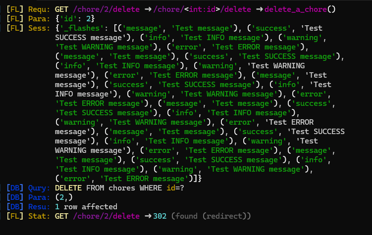
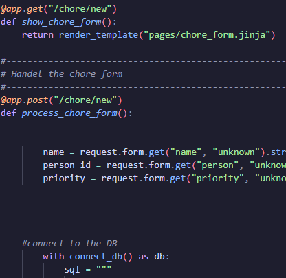
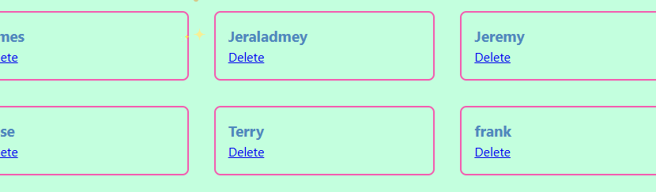
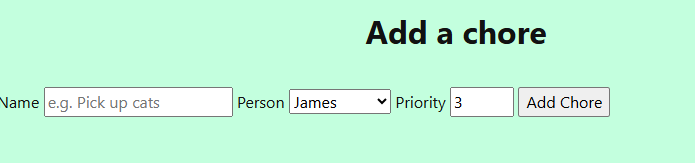
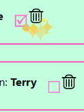
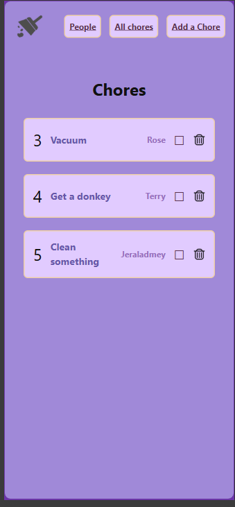
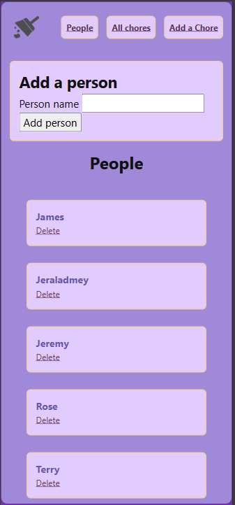
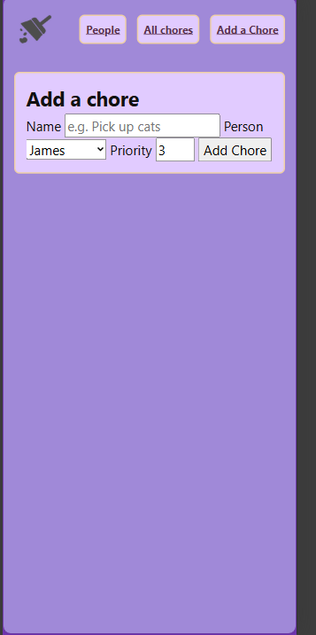

# Sprint 4 - Developing a Refined and Complete System

## Sprint Goals

Develop the system until it is fully featured, with a refined UI and it satisfies the requirements. The system will be fully tested at this point.

### Specific Goals

**Edit these goals as needed**

- Refine the design and UI of the website
- Refine the user experience (UX) of the system
- Perform final, full-system testing

## Testing deletion

I am fixing the delete by adding the chore.id to the SELECT query

### Changes / Improvements

the delete works now and I can finally delete my chores. 

## Testing adding chores

I am testing to make my form work 

### Changes / Improvements

I deleted a repeat in the code that was stopping the form from working, and now it works. The repeat was a with connect_db. I deleted the unnessecary one.  

## Testing to make people adding work

I am testing to add people to my form

### Changes / Improvements

I fixed the proccessing and now my form adds people

## making a drop down selection

I am making he chore form easier to add a name to it. 

### Changes / Improvements

I was able to make the people names and the priority a selection

## Fixing the done box

I am making the check boxes work

### Changes / Improvements

I fixed the boxes by switching the complete and imcomplete 

## Styling
This is my semi-final styling 

## Sprint Review

 This sprint has finished the coding off in the project and finalized the styling for my app. 

